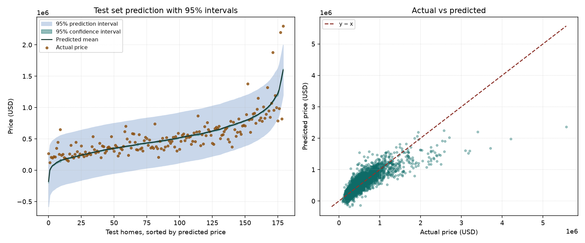
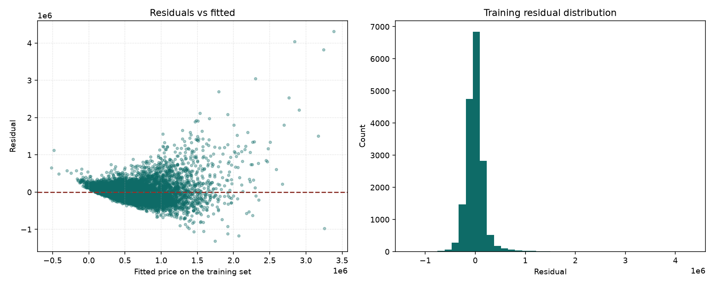

# 5115056011 HW2 多元線性迴歸

King County 房價的多元線性迴歸。流程依 CRISP-DM，模型是 `sklearn` 的 `LinearRegression`，並做特徵選擇與模型評估。

網頁：https://babyish23.github.io/AIoT-HW2-Multiple-Linear-regression/

資料集：[House Sales in King County, USA](https://www.kaggle.com/datasets/harlfoxem/housesalesprediction)

## 資料來源與研究脈絡

本地檔 `data/kc_house_data.csv`，共 21613 筆、21 欄，沒有缺值。目標是 `price`（最小 75000、中位數 450000、最大 7700000）。去掉 `id` 和 `date` 後有 **18 個原始預測變數**，同時落在作業要求的 10–20，以及補充條件的 14–39。

補充建議的第一名是 Predict the Flood（Kaggle Playground S4E5），原始 20 個數值特徵，本來最合適。不需登入就能下載的那份公開 CSV，`FloodProbability` 恰好等於 `0.005 × 20 個特徵的總和`，線性回歸測試 R² 為 1。那種資料做特徵選擇沒有意義，所以沒有拿來當成果。

`sqft_living`、`sqft_above`、`sqft_basement` 尺度大且彼此相關。`zipcode` 先保留成數字，交給特徵選擇判斷，不把它單獨解讀成「郵遞區號每加 1，房價就減多少」。

## CRISP-DM

1. **Business Understanding**：買家與估價需要一個可解釋的成交價模型，而不是只追求黑盒分數。
2. **Data Understanding**：21613 筆、無缺值。價格右偏，少數豪宅拉高平均。
3. **Data Preparation**：刪除 `id`、`date`。80/20 分割，`random_state=0`，訓練 17290、測試 4323。特徵選擇只用訓練集。
4. **Modeling**：`sklearn.linear_model.LinearRegression`。五條路徑是 Lasso 係數排序、Forward SFS、RFE、SelectKBest、Permutation Importance。另報 RidgeCV 當收縮對照，不混進 OLS 排名。
5. **Evaluation**：用測試集的 MSE、RMSE、MAE、R² 比較。最好的 OLS 子集再檢查殘差偏態、異質變異、Durbin-Watson 和 VIF。
6. **Deployment**：網頁用選出的係數做即時估價，並畫出 95% 信賴區間與 95% 預測區間。

重跑：

```bash
pip install -r requirements.txt
python hw2.py
```

## 結果

| 模型 | k | Test MSE | Test RMSE | Test MAE | Test R² |
| --- | ---: | ---: | ---: | ---: | ---: |
| 全部特徵 OLS | 18 | 36,326,416,754 | 190,595 | — | 0.6950 |
| RidgeCV（alpha 54.12） | 18 | 36,323,730,878 | — | — | 0.6950 |
| **Forward SFS** | **14** | **36,274,683,097** | **190,459** | **122,125** | **0.6954** |

各路徑在測試集上最好的一組：

| 方法 | k | Test MSE | Test R² |
| --- | ---: | ---: | ---: |
| Lasso（L1 排序） | 15 | 36,284,640,033 | 0.6953 |
| Forward SFS | 14 | 36,274,683,097 | 0.6954 |
| RFE | 15 | 36,274,683,097 | 0.6954 |
| SelectKBest | 18 | 36,326,416,754 | 0.6950 |
| Permutation Importance | 16 | 36,284,640,033 | 0.6953 |

採用的 14 個特徵：`sqft_living`、`lat`、`view`、`grade`、`yr_built`、`waterfront`、`bedrooms`、`bathrooms`、`zipcode`、`long`、`condition`、`sqft_above`、`sqft_living15`、`yr_renovated`。

18 個特徵幾乎全放，和只留 14 個，測試 R² 只差 0.0004。特徵選擇的價值是拿掉重疊的面積欄位，讓係數比較穩，不是把 R² 再拉高一截。Ridge 的測試誤差和全部特徵的 OLS 幾乎一樣，因為樣本數遠大於特徵數，收縮的幫助有限。這份資料沒有 Kaggle 名次。

## 預測圖與殘差

深色帶是 95% 信賴區間，淺色帶是 95% 預測區間。右圖是實際價格對預測價格。



殘差偏態 3.540。絕對殘差與配適值的相關 0.496。Durbin-Watson 2.010。最大 VIF 7.854。

房價右偏，殘差不是常態，而且房子越貴、誤差越大，變異數不齊。高價房屋會被低估。這是這類資料的常見現象。主模型仍用原始美元，讓區間可以直接讀成價格。



## 主流解法比較

King County 的公開筆記本多半把 `price` 取對數，再把 `zipcode` 做成目標編碼或分組，然後用 Random Forest 或 Gradient Boosting。那些模型的測試 R² 常常高於單純線性回歸，但係數不好直接解釋，也沒有線性模型這種預測區間。

這次保留線性回歸，用五種特徵選擇處理共線性，並把區間畫出來。若目標改成盡量提高預測分數，下一步才是對數價格、類別型 `zipcode`，以及樹模型。

## NotebookLM 摘要

King County 房價分析顯示，居住面積（`sqft_living`）與房屋等級（`grade`）為最關鍵變數。因 `sqft_living` 為 `sqft_above` 加地下室坪數，兩者高度相關，來源透過剔除 `sqft_above` 消除多重共線性；`zipcode` 因類別過多且無數字順序，不宜作為連續變數，需轉為類別編碼。為修正右偏與異質變異，來源對價格與坪數取對數，並以 Q-Q plot 與殘差圖檢查常態性。線性回歸具備高係數解釋力，但非線性預測力有限。樹模型（Random Forest、Gradient Boosting）預測力更高但缺乏直接解釋力。若作業規定使用線性回歸與特徵選擇，應保留 OLS 的顯著係數、p 值、VIF 及帶有區間的預測圖。在比較段落中，則應承認樹模型在捕捉非線性關係與預測精準度上通常優於線性回歸。


## GPT 輔助內容

對話用 ChatGPT Exporter 匯出，全文附在報告 PDF 後面，共 23 頁，檔案是 `report/GPT輔助內容.pdf`。

對話先討論符合條件的 Kaggle 資料集與 CRISP-DM 報告架構，接著依 King County 的實際設定撰寫正文：18 個特徵的 OLS、Forward SFS 的 14 個特徵、RidgeCV 對照、測試 MSE、RMSE、R²、五大回歸假設，以及信賴區間和預測區間的差別。對話也比較了對數價格、把 `zipcode` 當類別，以及 Random Forest、Gradient Boosting。這些模型常常預測得更好，但這次仍以可解釋的 OLS 作為主要結果。
